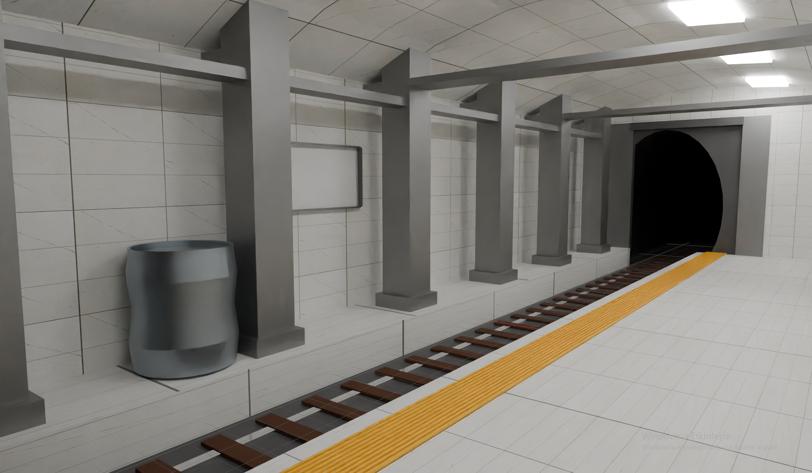
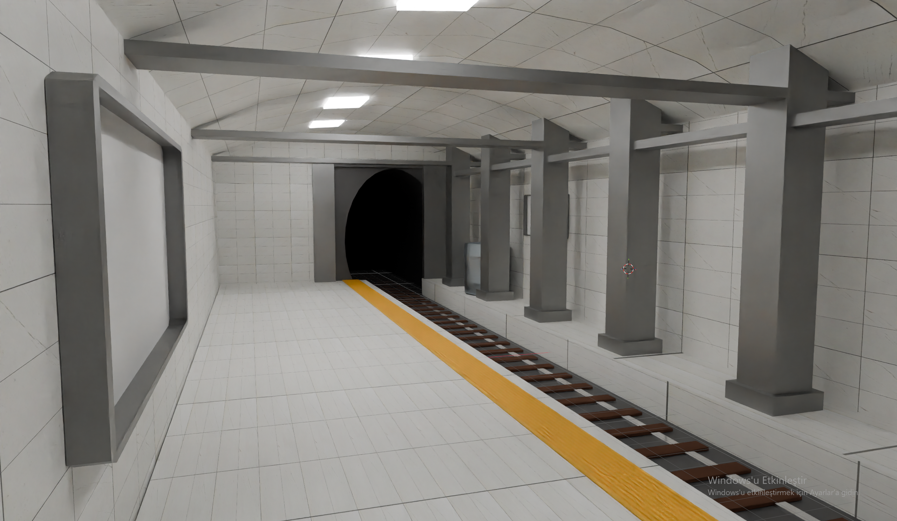

#  Tren İstasyonu

Blender ile modellediğim, yeraltı tren/metro istasyonu temalı 3D sahne projesi.

<p align="center">
  
  
</p>

##  Hakkında

Bu proje, tünel çıkışı olan bir tren istasyonu peronunu içeren bir Blender sahnesidir. Sahnede şunlar yer alıyor:

- Perona paralel uzanan raylar ve tünel girişi
- Peron kenarındaki sarı güvenlik şeridi
- Betonarme kolonlar ve tavan aydınlatmaları
- Mermer görünümlü zemin kaplaması

Proje; modelleme, malzeme/doku kaplama, aydınlatma ve render süreçlerini pratik etmek amacıyla hazırlandı.

## 🛠️ Gereksinimler

- [Blender](https://www.blender.org/download/) **5.2** veya üzeri

##  Klasör Yapısı

```
underground_train_station/
├── assets/            
├── images/            # Render çıktıları / ekran görüntüleri
│   ├── istasyon-1.png
│   └── istasyon-2.png
├── istasyon.blend     # Ana Blender proje dosyası
├── mermer.jpg         # Mermer zemin dokusu
└── README.md
```

##  Geliştirici

**Burak Yiğit**
GitHub: [@burakyigitsolmaz](https://github.com/burakyigitsolmaz)

##  Telif Hakkı

© 2026 Burak Yiğit. **Tüm hakları saklıdır.**

Bu projedeki modeller, sahne dosyası ve render görselleri bana aittir. Yazılı iznim olmadan kopyalanamaz, değiştirilemez, dağıtılamaz veya herhangi bir projede (ticari ya da ticari olmayan) kullanılamaz.

Kullanım izni veya iş birliği için benimle iletişime geçebilirsiniz: **solmazburakss@gmail.com**
